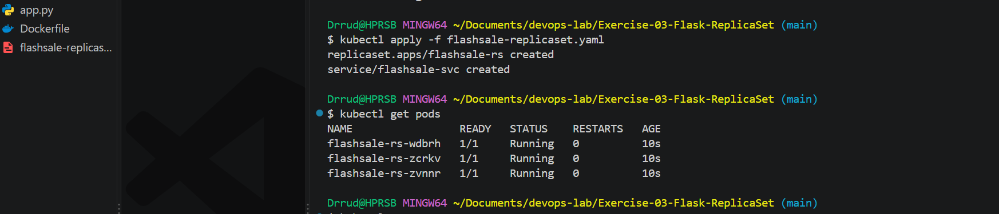
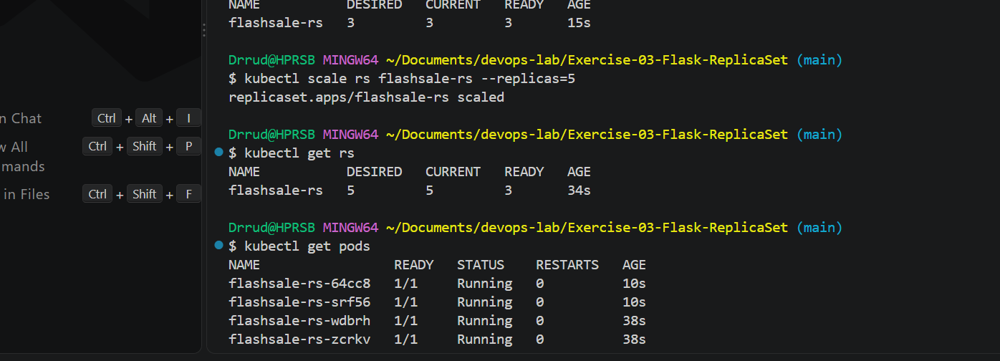
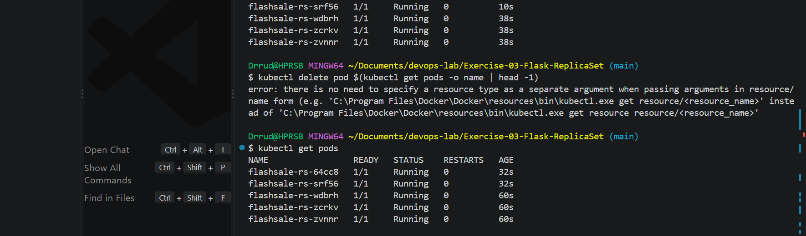
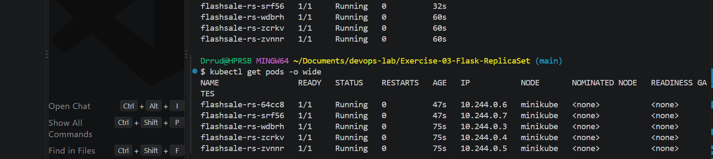
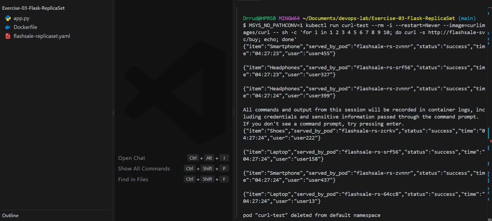

# Exercise 3: Scaling a Flask App on a Single Node using ReplicaSets

## Objective
- Understand ReplicaSets and Pods
- Scale a Flask app deployment
- Observe pod distribution

## Use Case
During an e-commerce flash sale, traffic can jump from 100 to 10,000 requests per minute. A single Pod would crash under that load. A ReplicaSet runs many identical Pods of the same app and spreads requests across them. When the sale ends, it can scale back down to save resources.

## Files in this exercise
| File | Purpose |
|---|---|
| `app.py` | Flask flash-sale app with `/`, `/buy` and `/health` |
| `Dockerfile` | Builds the image `flashsale:1.0` |
| `flashsale-replicaset.yaml` | ReplicaSet (3 replicas) and a ClusterIP Service |

## 1. The Flask App
- `/` welcomes users to the Big Sale.
- `/buy` simulates a checkout with a random product and shows which Pod served the request (`served_by_pod`).
- `/health` is used by the readiness and liveness probes.

## 2. Start a Single-Node Cluster
The earlier 3-node cluster from Exercise 10 was deleted first:

```bash
minikube delete -p devops-multinode
minikube start --nodes=1
kubectl get nodes
```

The node `minikube` is `Ready`.



## 3. Build the Image
```bash
docker build -t flashsale:1.0 .
minikube image load flashsale:1.0
minikube image ls
```

## 4. Create the ReplicaSet and Service
```bash
kubectl apply -f flashsale-replicaset.yaml
kubectl get pods
kubectl get rs
```

The ReplicaSet `flashsale-rs` starts with 3 replicas, and all 3 Pods are `Running`.

## 5. Scale to 5 Replicas
```bash
kubectl scale rs flashsale-rs --replicas=5
kubectl get rs
kubectl get pods
```

Kubernetes created 2 more Pods, so the ReplicaSet now has 5 Pods running.



## 6. Delete a Pod (Self-Healing)
```bash
kubectl delete pod <pod-name>
kubectl get pods
```

The ReplicaSet created a new Pod right away to replace the deleted one, so there are 5 Pods again.



## 7. Pod Distribution Across Nodes
```bash
kubectl get pods -o wide
```

All 5 Pods run on the single node `minikube`.



## 8. Load Distribution
The Service is `ClusterIP`, so it can only be reached from inside the cluster. Requests were sent from a temporary Pod:

```bash
kubectl run curl-test --rm -i --restart=Never --image=curlimages/curl -- sh -c 'for i in 1 2 3 4 5 6 7 8 9 10; do curl -s http://flashsale-svc/buy; echo; done'
```

The `served_by_pod` value changes between responses, which shows the Service spreading requests across the Pods.



## Changes from the Exercise Sheet
| Sheet | What I used | Why |
|---|---|---|
| `COPY ex3-flash-sale.py .` in the Dockerfile | `COPY app.py .` | The file is named `app.py` |
| Image name `flask-app` in the build step | `flashsale:1.0` | The YAML uses `flashsale:1.0` |
| `eval $(minikube docker-env)` | `minikube image load` | Works reliably on Windows with Git Bash |
| `imagePullPolicy` not set | `imagePullPolicy: Never` | Uses the local image and does not try to download it |
| `flask-app-rs` in the scale command | `flashsale-rs` | This is the ReplicaSet's real name in the YAML |
| `minikube delete` | `minikube delete -p devops-multinode` | The old cluster has a named profile |

## Questions and Answers

**Q1. What is the initial number of replicas in the ReplicaSet?**
3.

**Q2. How many Pods are running after applying the ReplicaSet configuration?**
3.

**Q3. What happens when you scale the ReplicaSet to 5 replicas?**
Kubernetes creates 2 additional Pods to reach the desired number of 5. The ReplicaSet then has 5 running Pods.

**Q4. What happens when you delete one Pod?**
The ReplicaSet notices that the number of Pods is below the desired count and creates a new Pod to replace it, so there are 5 Pods again.

**Q5. How does Kubernetes maintain the desired number of replicas?**
The ReplicaSet controller keeps comparing the number of running Pods with the desired count. If there are too few, it creates Pods, and if there are too many, it deletes Pods.

**Q6. How many nodes are running?**
1 (`minikube`).

**Q7. Where are the Pods running with respect to nodes?**
All 5 Pods run on the single node `minikube`.

## Conclusion
A ReplicaSet keeps a set number of identical Pods running. Scaling up and down is one command, a deleted Pod is replaced automatically, and the Service spreads requests across the Pods. This is how services handle traffic spikes such as flash sales.