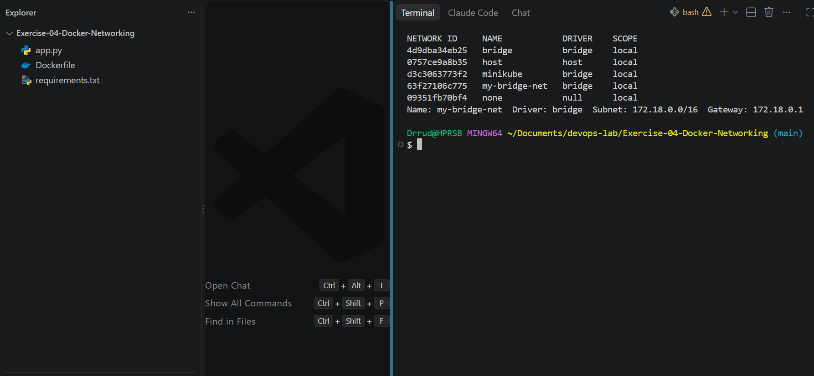
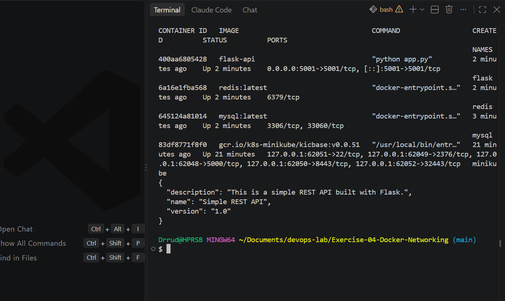
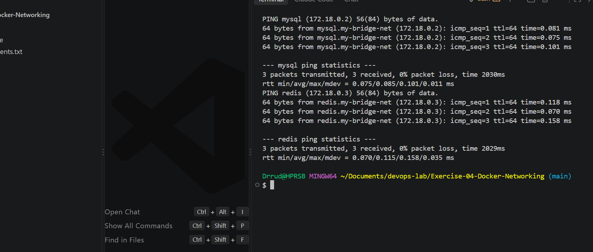
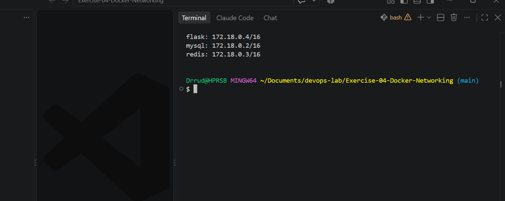

# Exercise 4: Docker Networking with Multiple Containers

## Objective
Understand Docker networking concepts and configure a multi-container application.

## Scenario
A web application made of three containers on one network:
- A Python Flask web server (container 1)
- A MySQL database (container 2)
- A Redis cache (container 3)

## Files in this exercise
| File | Purpose |
|---|---|
| `app.py` | Flask REST API with a `/about` endpoint on port 5001 |
| `requirements.txt` | Python dependencies |
| `Dockerfile` | Builds the `flask-api` image |

## 1. Create a Bridge Network
```bash
docker network create --driver bridge my-bridge-net
```

## 2. Verify the Network
```bash
docker network ls
docker network inspect my-bridge-net --format "Name: {{.Name}}  Driver: {{.Driver}}  Subnet: {{(index .IPAM.Config 0).Subnet}}  Gateway: {{(index .IPAM.Config 0).Gateway}}"
```

The network `my-bridge-net` uses the `bridge` driver with subnet `172.18.0.0/16` and gateway `172.18.0.1`.



## 3. Build the Flask Image
```bash
docker build -t flask-api .
```

## 4. Launch the Containers
```bash
docker run -d --name mysql --net=my-bridge-net -e MYSQL_ROOT_PASSWORD=rootpass mysql:latest
docker run -d --name redis --net=my-bridge-net redis:latest
docker run -d --name flask --net=my-bridge-net -p 5001:5001 flask-api
docker ps
curl http://localhost:5001/about
```

All three containers are `Up`, and the Flask API answers on port 5001.



## 5. Test Connectivity
`ping` is not included in the slim Python image, so it was installed in the running Flask container first:

```bash
docker exec flask bash -c "apt-get update && apt-get install -y iputils-ping"
docker exec flask ping -c 3 mysql
docker exec flask ping -c 3 redis
```

The Flask container reaches `mysql` and `redis` by name, with no packet loss. Docker's built-in DNS resolves container names on a user-defined network.



All three containers on the network:

```bash
docker network inspect my-bridge-net --format "{{range .Containers}}{{.Name}}: {{.IPv4Address}}{{println}}{{end}}"
```



## 6. Clean Up
```bash
docker stop mysql redis flask
docker rm mysql redis flask
docker network rm my-bridge-net
```

## Changes from the Exercise Sheet
| Sheet | What I used | Why |
|---|---|---|
| `docker run ... mysql:latest` | Added `-e MYSQL_ROOT_PASSWORD=rootpass` | MySQL exits at start-up without a root password |
| `app.run(debug=True, port=5001)` | Added `host='0.0.0.0'` | Without it the app only listens inside its own container, so the host cannot reach it |
| `Flask==2.0.1` only | Added `Werkzeug==2.0.3` | Flask 2.0.1 fails with newer Werkzeug versions |
| `ping` in the Flask container | Installed `iputils-ping` first | The slim Python image has no `ping` |
| `docker exec -it flask bash` | `docker exec flask <command>` | Avoids the "not a TTY" error in Git Bash on Windows |

## Questions and Answers

**Q1. What is the purpose of the `--net` flag in `docker run`?**
It tells Docker which network to connect the container to. Containers on the same user-defined network can reach each other.

**Q2. How do containers communicate with each other on the same network?**
They use each other's container names (resolved by Docker's DNS) or IP addresses. In this exercise, the Flask container reached the others with `ping mysql` and `ping redis`.

**Q3. What is the difference between a bridge network and a host network?**
A bridge network gives containers a private network, isolated from the host, and they talk to each other through it. A host network removes that isolation, because the container shares the host's network stack directly.
- Bridge: containers are in a private room and talk to each other through a door.
- Host: containers are in the same room as the host and talk directly to everyone.

**Q4. How can you expose a container's port to the host machine?**
Use the `-p` flag with the host port first and the container port second, for example `-p 5001:5001`. This exercise used it for the Flask container.

## Conclusion
Containers on a user-defined bridge network can find each other by name, stay isolated from other networks, and expose only the ports that are published with `-p`.