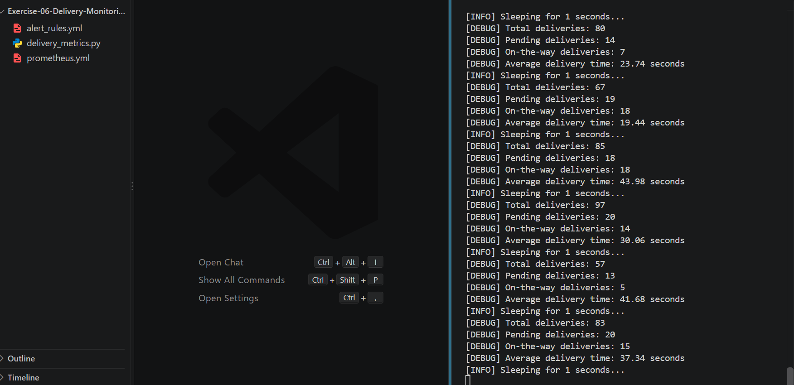
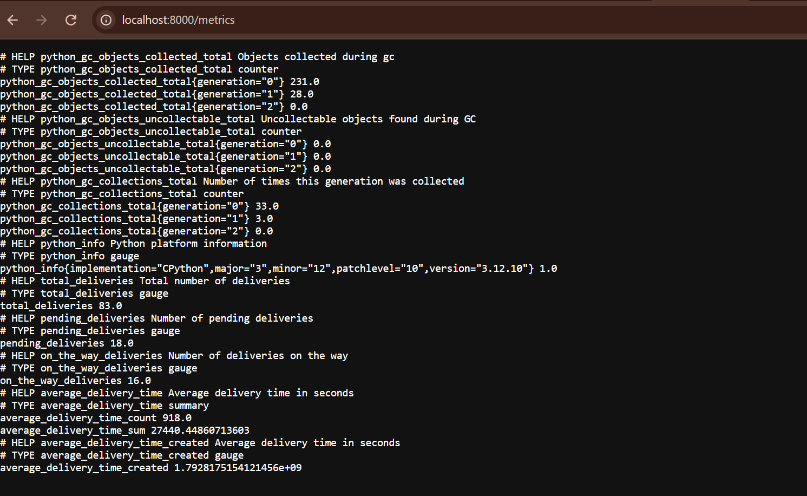
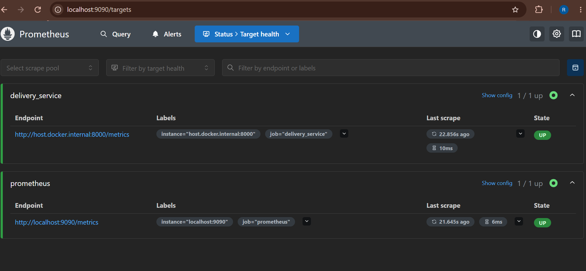
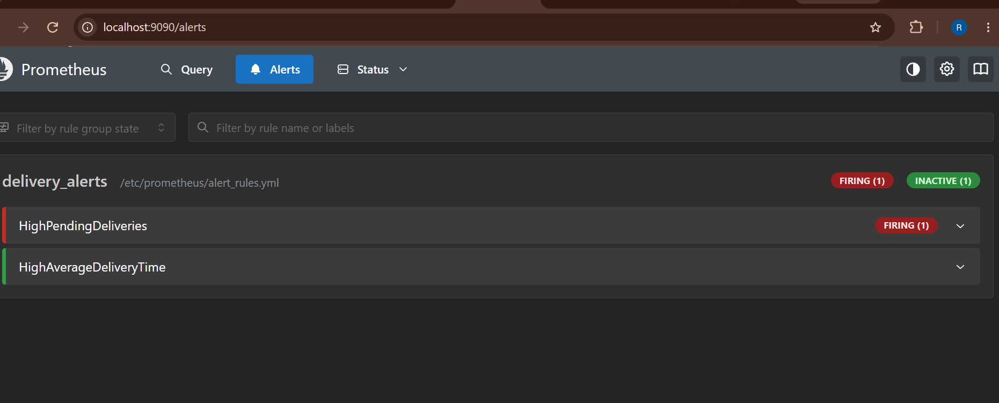
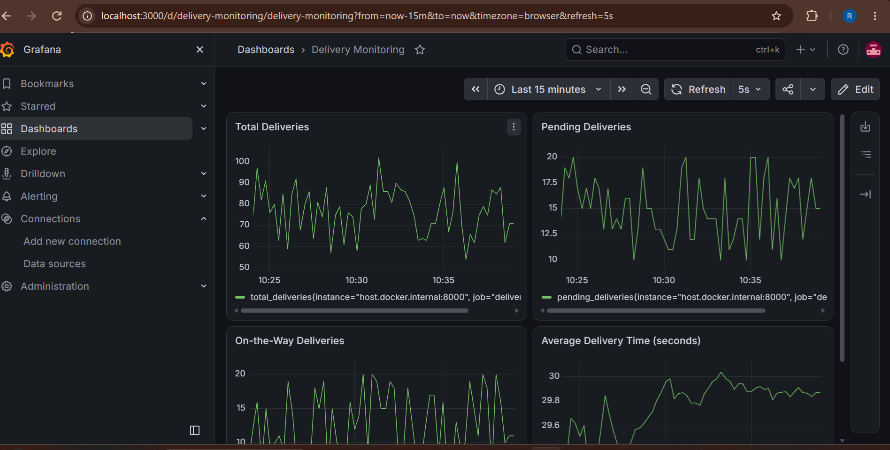
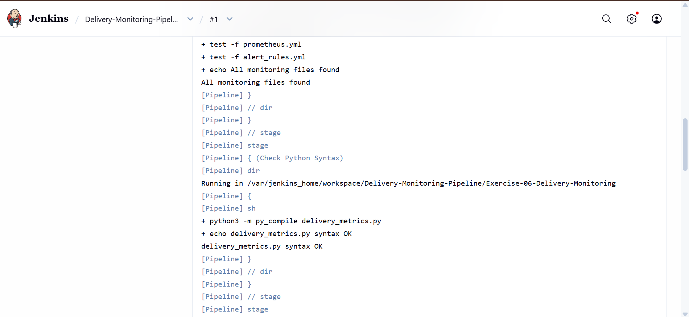
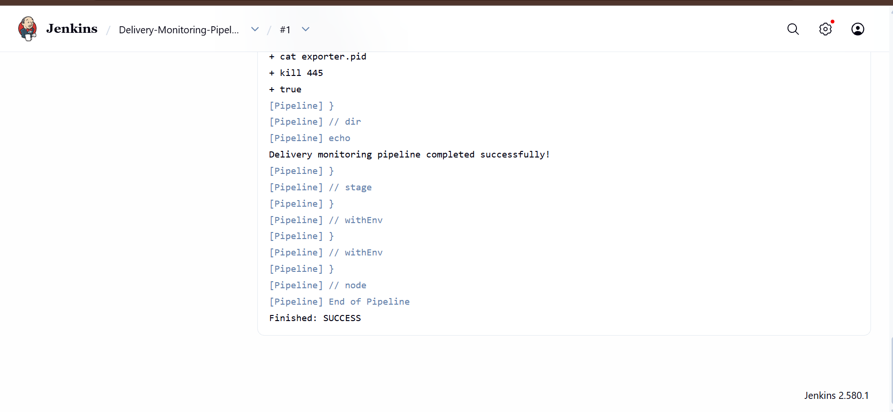
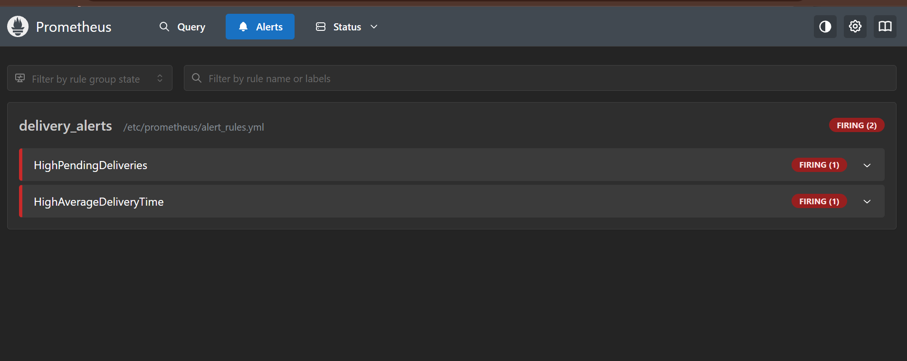
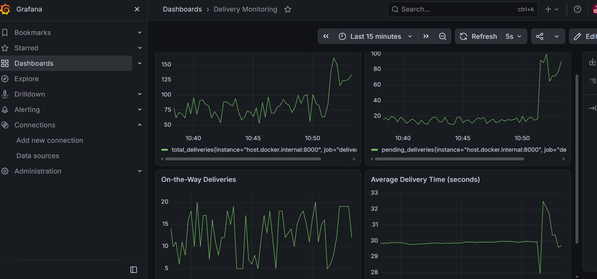

# Exercise 6: Real-Time Operations Monitoring and Alerting

## Objective
Build a monitoring pipeline for a delivery service (ZAPPTTO) using Python, Prometheus, Grafana and Jenkins. A Python script simulates delivery metrics, Prometheus scrapes them and raises alerts, Grafana shows them on a dashboard, and Jenkins checks the setup automatically.

## Files in this exercise
| File | Purpose |
|---|---|
| `delivery_metrics.py` | Simulates delivery metrics and serves them on port 8000 |
| `prometheus.yml` | Prometheus scrape configuration |
| `alert_rules.yml` | Alert rules for pending deliveries and delivery time |
| `Jenkinsfile` | Jenkins pipeline that checks the monitoring setup |

## 1. The Metrics Script
`delivery_metrics.py` uses `prometheus_client` and exposes four metrics at `http://localhost:8000/metrics`:
- `total_deliveries` (Gauge)
- `pending_deliveries` (Gauge)
- `on_the_way_deliveries` (Gauge)
- `average_delivery_time` (Summary)

```bash
pip install prometheus-client
python delivery_metrics.py
```





## 2. Prometheus
Prometheus runs in Docker and scrapes the script every 5 seconds:

```bash
docker run -d --name prometheus -p 9090:9090 \
  -v "$(pwd -W)/prometheus.yml:/etc/prometheus/prometheus.yml" \
  -v "$(pwd -W)/alert_rules.yml:/etc/prometheus/alert_rules.yml" \
  prom/prometheus
```

Both targets (`prometheus` and `delivery_service`) are **UP**.



## 3. Alert Rules
| Alert | Condition | Severity |
|---|---|---|
| `HighPendingDeliveries` | `pending_deliveries > 10` for 15 seconds | warning |
| `HighAverageDeliveryTime` | `average_delivery_time_sum / average_delivery_time_count > 30` | critical |



## 4. Grafana Dashboard
```bash
docker run -d --name grafana -p 3000:3000 grafana/grafana
```

Prometheus was added as a data source with the URL `http://host.docker.internal:9090`. The **Delivery Monitoring** dashboard has four panels:
1. Total Deliveries: `total_deliveries`
2. Pending Deliveries: `pending_deliveries`
3. On-the-Way Deliveries: `on_the_way_deliveries`
4. Average Delivery Time: `average_delivery_time_sum / average_delivery_time_count`



## 5. Jenkins Pipeline
The job `Delivery-Monitoring-Pipeline` uses **Pipeline script from SCM** with the Script Path `Exercise-06-Delivery-Monitoring/Jenkinsfile`. Its stages are:
1. **Check Files:** all monitoring files exist
2. **Check Python Syntax:** `delivery_metrics.py` compiles
3. **Validate Prometheus Config:** both YAML files parse and the alert rules are listed
4. **Run Metrics Exporter:** starts the script and checks that the four metrics are served

The build finished with `Finished: SUCCESS`.





## 6. Simulating a Busy Period
`pending_deliveries` was raised to `random.randint(50, 100)` in `delivery_metrics.py`, and the script was restarted. The Pending Deliveries graph jumped to the new level, and `HighPendingDeliveries` was **FIRING**.





## Changes from the Exercise Sheet
| Sheet | What I used | Why |
|---|---|---|
| `alerts_rules.yml` in the directory listing | `alert_rules.yml` | The config and commands use this name |
| `--network=host` and target `172.17.0.1:8000` | `-p 9090:9090` and `host.docker.internal:8000` | Host networking and `172.17.0.1` only work on Linux, not Docker Desktop on Windows |
| Grafana data source `http://172.17.0.1:9090` | `http://host.docker.internal:9090` | Same reason |
| Default scrape interval (15s) | `scrape_interval: 5s` and `evaluation_interval: 5s` | Alerts show up within seconds |
| Grafana panels built by hand | Dashboard imported from JSON | The new Grafana layout has no "Add visualization" button |
| Jenkinsfile that copies files from `/path/to/your/local/files` and runs `docker build` | A Jenkinsfile that checks the code out from GitHub and tests it | The path does not exist, there is no Dockerfile, and the Jenkins container has no Docker |
| Second Jenkins container | The existing `jenkins` container | Port 8080 was already in use |
| Jenkins started with a bare `docker run` | Python, `prometheus-client`, `PyYAML` and `curl` installed in the Jenkins container | The default image has none of them |

## Conclusion
A Python script produced delivery metrics, Prometheus scraped them and evaluated alert rules, Grafana charted them, and a Jenkins pipeline checked the whole setup. Raising `pending_deliveries` showed the alert reacting, which is how problems get noticed quickly in a real delivery service.