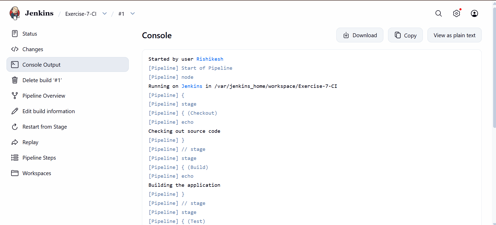
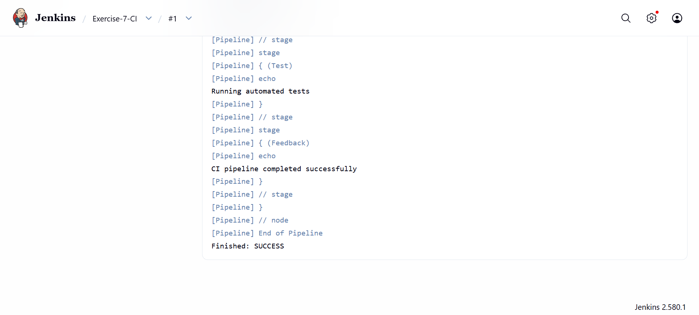

# Exercise 7: Continuous Integration (CI) and Jenkins

## Objective
Learn the fundamentals of Continuous Integration (CI), understand Jenkins concepts, and create and run a simple Jenkins Pipeline.

## 1. Continuous Integration (CI)
Continuous Integration is a development practice where developers frequently integrate code changes into a shared repository. A CI server builds and tests the changes and provides feedback.

### Key Features
- Frequent code integration
- Automated builds
- Automated testing
- Immediate feedback

### Benefits
- Early detection of bugs and integration issues
- Improved collaboration
- Faster development cycles
- Better software quality through automated checks

## 2. CI Workflow
1. A developer commits and pushes code to a shared Git repository.
2. A CI server detects the change and starts a pipeline.
3. The pipeline builds the application and runs tests.
4. The CI server reports success or failure to the developer.

## 3. Jenkins Concepts
- **Job/Project:** A task or process configured in Jenkins.
- **Build:** One execution of a Jenkins job.
- **Pipeline:** A sequence of stages and steps used to automate work.
- **Plugins:** Extensions that add Jenkins features.
- **Nodes:** Machines or environments where Jenkins jobs run.

## 4. Jenkins Setup
Jenkins was run in Docker using:

```bash
docker run -d --name jenkins -p 8080:8080 -p 50000:50000 -v jenkins_home:/var/jenkins_home jenkins/jenkins:lts
```

Jenkins dashboard: http://localhost:8080/

## 5. Create the Pipeline Job
1. Open the Jenkins dashboard.
2. Click **New Item**.
3. Enter `Exercise-7-CI` as the item name.
4. Select **Pipeline** and click **OK**.
5. Under Definition, select **Pipeline script**.
6. Paste the pipeline script and click **Save**.

## 6. Pipeline Script

```groovy
pipeline {
    agent any

    stages {
        stage('Checkout') {
            steps {
                echo 'Checking out source code'
            }
        }

        stage('Build') {
            steps {
                echo 'Building the application'
            }
        }

        stage('Test') {
            steps {
                echo 'Running automated tests'
            }
        }

        stage('Feedback') {
            steps {
                echo 'CI pipeline completed successfully'
            }
        }
    }
}
```

**Note:** This is a demonstration pipeline. Its stages print messages; they do not actually check out a repository, compile an application, or run a test suite.

## 7. Run and Verify
1. Open the `Exercise-7-CI` job.
2. Click **Build Now**.
3. Click the new build number (for example, #1).
4. Click **Console Output**.
5. Confirm the Checkout, Build, Test, and Feedback stages ran and the last line is `Finished: SUCCESS`.

## 8. Result
The pipeline ran successfully. All four stages (Checkout, Build, Test, Feedback) completed and the build finished with `Finished: SUCCESS`.

### Console Output (start of the build)


### Console Output (end of the build)


## 9. Troubleshooting
- **Syntax error (unexpected token):** Check the braces and replace the script with the complete version above.
- **Build fails:** Open the failed build, read Console Output, fix the first error, and rerun.

## 10. Conclusion
This exercise introduced CI concepts and Jenkins terminology, and demonstrated how to create and run a basic Jenkins Pipeline.