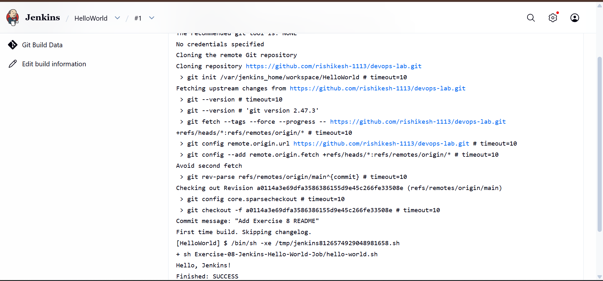
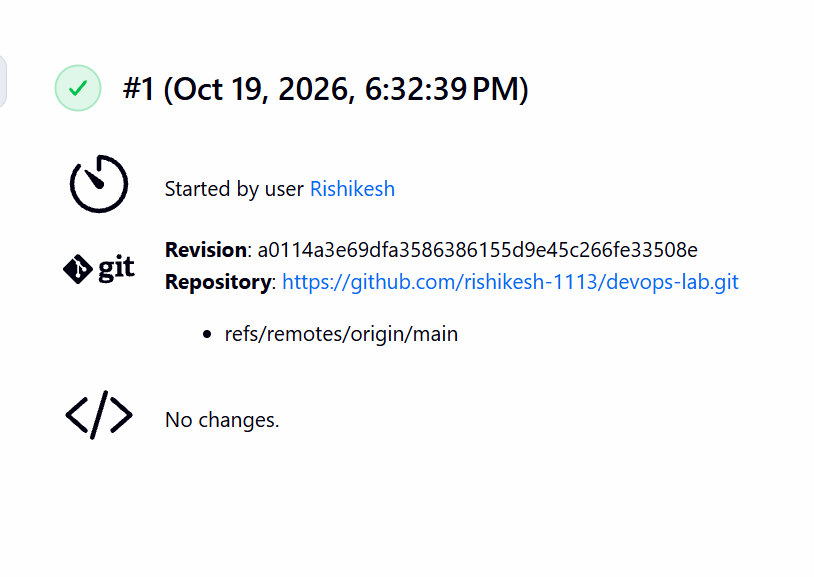

# Exercise 8: Creating a "Hello World" Jenkins Job

## Objective
Create a simple script, store it in a Git repository on GitHub, and run it from a Jenkins Freestyle job.

## 1. The Script
File: `hello-world.sh`

```bash
#!/bin/bash
echo "Hello, Jenkins!"
```

The script was saved with LF line endings so it runs correctly on Linux, which is what Jenkins uses.

## 2. Push the Script to GitHub
```bash
git add Exercise-08-Jenkins-Hello-World-Job/
git commit -m "Add Exercise 8 hello-world.sh"
git push origin main
```

The script is stored in the `devops-lab` repository:
https://github.com/rishikesh-1113/devops-lab

## 3. Create the Jenkins Job
1. Open Jenkins at http://localhost:8080 and log in.
2. Click **New Item**.
3. Enter the name `HelloWorld`, select **Freestyle project**, and click **OK**.
4. In the description, enter: `Hello World! Jenkins job.`
5. Under **Source Code Management**, select **Git** and enter the repository URL:
   `https://github.com/rishikesh-1113/devops-lab.git`
6. Set the branch specifier to `*/main`.
7. Under **Build Steps**, click **Add build step > Execute shell** and enter:

```bash
sh Exercise-08-Jenkins-Hello-World-Job/hello-world.sh
```

8. Click **Save**.

## 4. Run the Job
1. On the job page, click **Build Now**.
2. Click the build number (for example, #1).
3. Click **Console Output**.

## 5. Result
The job ran successfully. Jenkins cloned the repository, ran the script, and printed `Hello, Jenkins!`.

```
+ sh Exercise-08-Jenkins-Hello-World-Job/hello-world.sh
Hello, Jenkins!
Finished: SUCCESS
```

### Console Output


### Build Summary


## 6. Conclusion
This exercise showed how to store a script in GitHub and have Jenkins pull and run it automatically. Jenkins cloned the repository, checked out the latest commit, executed `hello-world.sh`, and finished with `Finished: SUCCESS`.