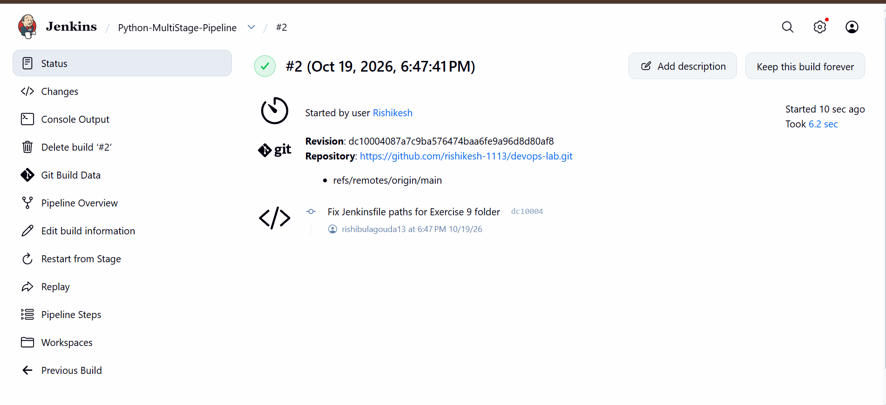
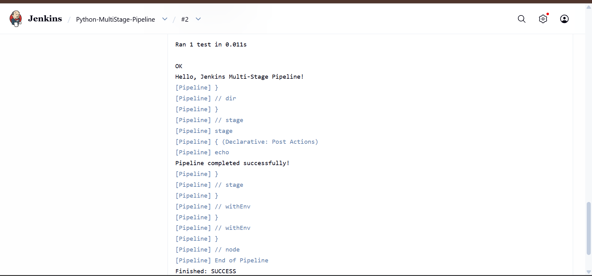
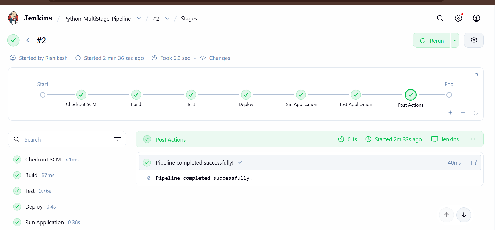

# Exercise 9: Jenkins Multi-Stage Pipeline for a Python Application

## Objective
Create and run a Jenkins Pipeline with multiple stages (Build, Test, Deploy, Run Application, Test Application) for a sample Python Flask application.

## 1. Application Files
- `app.py`: Flask app that returns "Hello, Jenkins Multi-Stage Pipeline!"
- `requirements.txt`: `flask==2.1.2`
- `test_app.py`: unit test for the home route
- `Jenkinsfile`: the pipeline definition

## 2. Push to GitHub
```bash
git add app.py requirements.txt test_app.py Jenkinsfile
git commit -m "Add Exercise 9 Flask app and Jenkinsfile"
git push origin main
```

Repository: https://github.com/rishikesh-1113/devops-lab

## 3. Install Python in the Jenkins Container
The default Jenkins image has no Python, so it was installed inside the container:

```bash
docker exec -it -u root jenkins bash
apt-get update
apt-get install -y python3 python3-pip python3-venv python3-flask
python3 --version
exit
```

## 4. Create the Jenkins Job
1. Click **New Item**, enter `Python-MultiStage-Pipeline`, select **Pipeline**, click **OK**.
2. Under Pipeline, set Definition to **Pipeline script from SCM**.
3. SCM: **Git**, Repository URL: `https://github.com/rishikesh-1113/devops-lab.git`
4. Branch Specifier: `*/main`
5. Script Path: `Exercise-09-Jenkins-Multistage-Pipeline/Jenkinsfile`
6. Click **Save**.

## 5. Build Error and Fix
The first build (#1) failed with `Ran 0 tests` and `NO TESTS RAN`. The repository holds several exercises, so Jenkins ran the tests from the top-level folder, where `test_app.py` does not exist.

The fix was to update the Jenkinsfile to define `APP_DIR` and run the test stages inside that folder using `dir("${APP_DIR}")`. The Deploy stage copies `app.py` from `APP_DIR`.

## 6. Pipeline Stages
| Stage | What it does |
|---|---|
| Build | Prints a message about installing dependencies |
| Test | Runs `python3 -m unittest discover -s .` |
| Deploy | Copies `app.py` to a `python-app-deploy` directory |
| Run Application | Starts the app in the background with `nohup` |
| Test Application | Runs `test_app.py` |

## 7. Result
Build #2 finished with `Finished: SUCCESS`. The test ran and passed, and the app printed `Hello, Jenkins Multi-Stage Pipeline!`.

### Build Summary


### Console Output


### Stage View


## 8. Conclusion
This exercise showed how to run a multi-stage Jenkins pipeline from a Jenkinsfile in GitHub, install the tools it needs in the Jenkins container, and fix a path problem when the project sits in a subfolder of a shared repository.