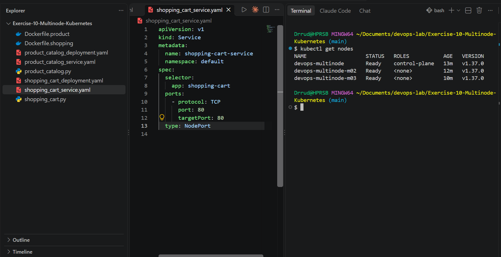
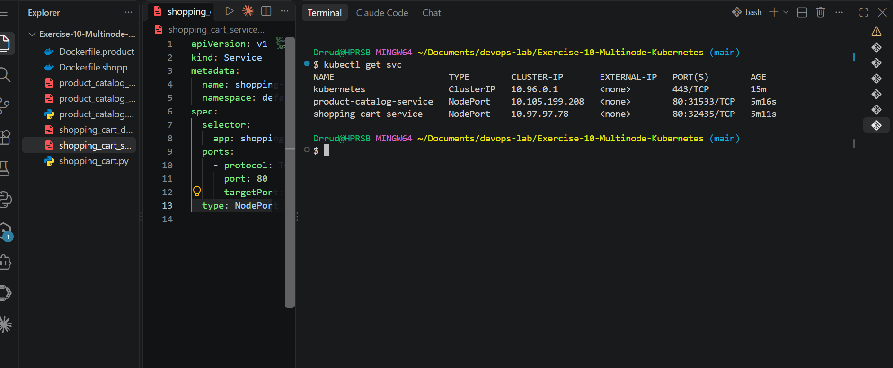
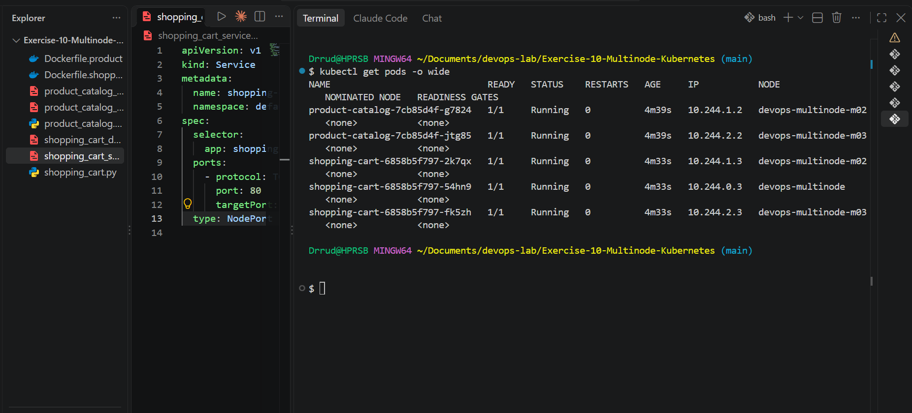
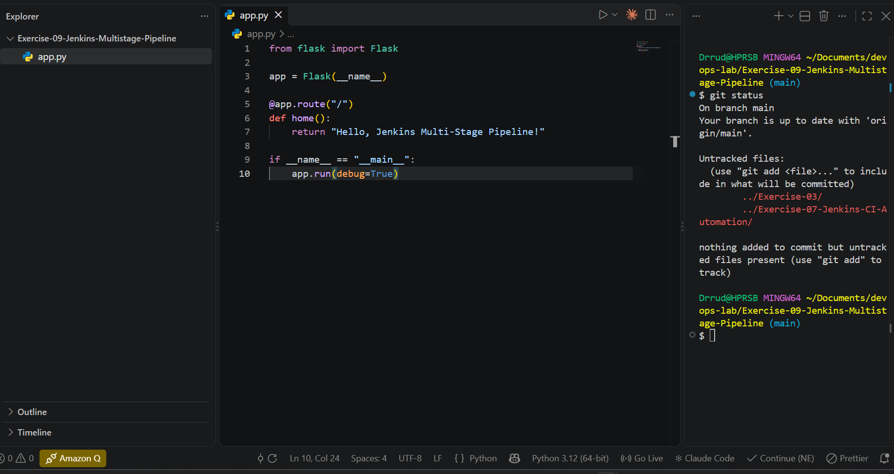

# Exercise 10: Multi-Node Kubernetes Cluster with Multiple Applications and ReplicaSets

## Objective
Deploy two Flask applications on a 3-node Minikube cluster with multiple replicas, spread across different nodes for high availability.

- **Product Catalog (AppA):** 2 replicas
- **Shopping Cart (AppB):** 3 replicas

## Files in this exercise
| File | Purpose |
|---|---|
| `product_catalog.py` | Flask app with `GET /products` |
| `shopping_cart.py` | Flask app with `GET /cart` and `POST /cart` |
| `Dockerfile.product` | Image for the Product Catalog |
| `Dockerfile.shopping` | Image for the Shopping Cart |
| `product_catalog_deployment.yaml` | Deployment with 2 replicas |
| `shopping_cart_deployment.yaml` | Deployment with 3 replicas |
| `product_catalog_service.yaml` | NodePort service for the Product Catalog |
| `shopping_cart_service.yaml` | NodePort service for the Shopping Cart |

## 1. Start the 3-Node Cluster
```bash
minikube start --nodes 3 -p devops-multinode
kubectl get nodes
```

All three nodes (`devops-multinode`, `devops-multinode-m02`, `devops-multinode-m03`) are `Ready`.



## 2. Application Code
- `product_catalog.py` returns a list of products at `/products`.
- `shopping_cart.py` returns the cart at `GET /cart` and adds an item at `POST /cart`.

Both apps listen on port 80.

## 3. Dockerize the Applications
```bash
docker build -t product-catalog:latest -f Dockerfile.product .
docker build -t shopping-cart:latest -f Dockerfile.shopping .
docker images
```

## 4. Load the Images into Minikube
The Minikube nodes cannot see images built on the host, so the images are loaded into the cluster:

```bash
minikube -p devops-multinode image load product-catalog:latest
minikube -p devops-multinode image load shopping-cart:latest
minikube -p devops-multinode image ls
```

## 5. Deploy the Applications
```bash
kubectl apply -f product_catalog_deployment.yaml
kubectl apply -f shopping_cart_deployment.yaml
```

Both deployments use `podAntiAffinity` with `topologyKey: kubernetes.io/hostname`, so no two pods of the same app run on the same node. They also use `imagePullPolicy: Never`, so Kubernetes uses the images loaded in step 4.

**Note:** The exercise sheet put the Shopping Cart deployment in the `devops-exercise` namespace but its service in `default`. I used `default` for both, so the service can find its pods.

## 6. Expose the Services
```bash
kubectl apply -f product_catalog_service.yaml
kubectl apply -f shopping_cart_service.yaml
kubectl get svc
```

Both services are of type `NodePort` on port 80.



## 7. Verify Pod Distribution
```bash
kubectl get pods -o wide
```

All 5 pods are `Running`. Each app's pods are on different nodes:
- **product-catalog (2 pods):** `devops-multinode-m02` and `devops-multinode-m03`
- **shopping-cart (3 pods):** `devops-multinode`, `devops-multinode-m02` and `devops-multinode-m03`



## 8. Access and Test the Services
On Windows with the Docker driver, Minikube opens a tunnel, and the terminal running it must stay open. Each service was started in its own terminal:

```bash
minikube -p devops-multinode service product-catalog-service --url
minikube -p devops-multinode service shopping-cart-service --url
```

The tunnel ports change each time a tunnel starts. In this run they were `58676` (Product Catalog) and `58682` (Shopping Cart).

```bash
curl http://127.0.0.1:58676/products
curl http://127.0.0.1:58682/cart
curl -X POST http://127.0.0.1:58682/cart -H "Content-Type: application/json" -d '{"id": 1, "name": "Laptop", "quantity": 1}'
```

Results:
- `/products` returned the three products (Laptop, Phone, Headphones).
- `GET /cart` returned an empty cart `[]`.
- `POST /cart` added the Laptop and returned the updated cart.



## 9. Conclusion
Two Python applications were deployed on a multi-node Minikube cluster with replicas, and every pod of an app runs on a different node. If one node fails, the remaining pods keep the services available.